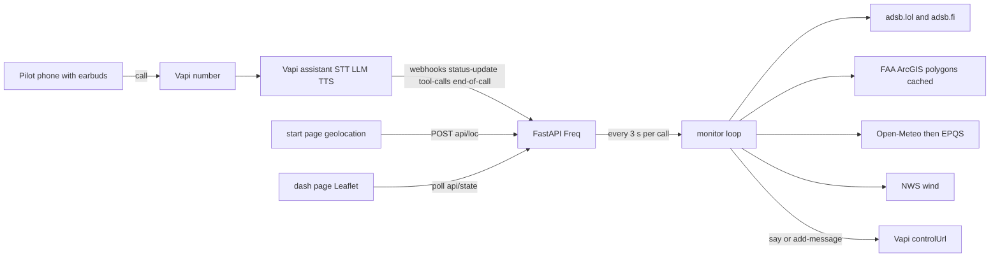

# Freq

A beginner drone pilot calls one phone number before takeoff. Freq stays on the line like a radio for the flight. Using the phone's location as a stand-in for the drone (assume the aircraft stays within about 400 feet horizontally), it says how high you may fly here and when to descend because a manned aircraft is nearby.

**Advisory only.** Freq is not air traffic control and does not replace a visual observer. It only knows aircraft that broadcast ADS-B. Helicopters, gliders, and paragliders often do not.

The demo covers San Diego only (latitude 32.53–33.25, longitude -117.35 to -116.85). Anywhere else, Freq says: "Freq demo covers San Diego only."

## How it fits together



The position captured before the pilot taps the phone number is the takeoff fix. iOS suspends the browser when the Phone app opens. The dashboard shows position age and never waits on a fresh fix. Come back to the start page after dialing so updates can resume.

## Data sources

Every outbound request sends `User-Agent: Freq/0.1 (hackathon)`. A source that fails is skipped. A call does not crash.

| Source | What Freq uses |
| --- | --- |
| [adsb.lol](https://api.adsb.lol) `/v2/point` and `/v2/mil` | Aircraft within 10 NM. Fallback: [adsb.fi](https://opendata.adsb.fi). Cached per 0.05° cell for 3 s, at most one request per second. `alt_baro: "ground"` and `seen_pos` older than 15 s are skipped. |
| FAA ArcGIS org `ssFJjBXIUyZDrSYZ` | One envelope fetch for San Diego, paginated at 2,000 features: UAS facility map, Class Airspace, `DoD_Mar_13` (national-security UAS restrictions), Prohibited Areas, Special Use Airspace, Stadiums, National Defense Airspace TFRs. Cached under `data/cache/`. Point-in-polygon is local. |
| [Open-Meteo elevation](https://api.open-meteo.com/v1/elevation) | Primary ground elevation. [USGS EPQS](https://epqs.nationalmap.gov/v1/json) refines it in the background with a 3 s timeout. |
| [api.weather.gov](https://api.weather.gov) | Wind. Values arrive in km/h. Gusts may be null. Speech is knots. |
| [Vapi](https://api.vapi.ai) | Phone call, tools, and live-call `say` / `add-message`. |

LAANC is required only for a facility-map grid hit, surface Class B/C/D (`LOWER_CODE` SFC or `LOWER_VAL` 0), or `LOCAL_TYPE` `CLASS_E2`. Class E3/E4/E5/E6 shelves do not lower the 400 ft Class G default. A Class B floor overhead, such as 1,800 ft MSL at UCSD, is informational only. A national-security UAS polygon (NAS North Island and the other `DoD_Mar_13` sites) is do-not-fly. Ceilings printed at startup were queried. If a layer did not load, the table says unavailable instead of inventing a number.

Torrey Pines glider activity is an advisory polygon that lowers the recommended ceiling. It is not airspace. Torrey Pines State Reserve and Cabrillo National Monument notes are land-manager advisories, not airspace.

Speech uses statute miles and knots. The internal math is nautical miles, converted in `app/geo.py`. Spoken altitudes round to the nearest 100 feet. Tail numbers are never spoken.

Closing traffic uses closest-point-of-approach from track and groundspeed while the pilot is treated as stationary. An alert fires when CPA is within 1 statute mile and time-to-CPA is within 120 seconds, inside 3 statute miles and 1,500 ft AGL. If track or speed is missing, Freq falls back to range decreasing across two samples. Airliners in categories A3/A4/A5 above 1,000 ft AGL stay off the calm drip tier. Helicopters (A7) and light aircraft (A1/A2) are the traffic that matters. Each aircraft waits 45 seconds before the same tier repeats. Moving up a tier (drip to alert, alert to land-now) skips that wait. At most one injection goes out every 8 seconds. A 90 second all-clear comes from the monitor, not from Vapi idle messages.

## Run

Python 3.12. From this directory:

```bash
python3 -m venv .venv
source .venv/bin/activate
pip install -r requirements.txt
cp .env.example .env
```

Edit `.env`. Leave the Vapi lines empty until you have them. The app and the offline tests do not need a key.

```bash
uvicorn app.main:app --host 0.0.0.0 --port 8000
```

On startup Freq downloads the San Diego polygons (or reads `data/cache/` after the first success) and prints a ceiling for every named spot.

In another terminal, expose port 8000 on a free ngrok static domain so the URL survives restarts:

```bash
ngrok http --url=<name>.ngrok-free.app 8000
```

Put `https://<name>.ngrok-free.app` in `PUBLIC_BASE_URL`. The browser warning on the first visit to `/start` is the ngrok interstitial. Webhooks are not affected. Set `WEBHOOK_TOKEN` to a long random string. The path is `/vapi/webhook/<token>`.

Then:

```bash
python scripts/check_sources.py
python scripts/create_assistant.py
```

`create_assistant.py` is idempotent. It prints the assistant id and PATCHes `VAPI_PHONE_NUMBER_ID` with that id. With no `VAPI_API_KEY` it exits non-zero and does not call the API. `silenceTimeoutSeconds` is sent and retried without that field if Vapi returns 400.

Open `http://127.0.0.1:8000/start` on the phone (or the ngrok URL). Enter the number you will call from, tap **Start flight**, and note the 4-digit Freq code. Call **+1 858-348-9143**. If caller ID does not match, Freq asks for the code and links the call. The operator map is `/dash`: pilot, aircraft, ceiling polygons, event log, spot list, and the replay button.

Check the loop without a phone:

```bash
python scripts/simulate_call.py
```

That posts a fake `status-update`, tool calls, and `end-of-call-report`. The fake `controlUrl` points at `/debug/control` on the same server.

`DEMO_LOCATION=32.8801,-117.2340` pins a simulated fix. `DEMO_MODE=replay` starts `demo/heli_track.json` when a call connects. The track is offsets from the pilot, so it works at any spot. `POST /api/replay/start` starts it from the dashboard. `python scripts/record_track.py --lat 32.88 --lon -117.23` can write a new offset track from live ADS-B.

```bash
pytest
```

Tests use fixture polygons and a synthetic track. They do not touch the network.

## What you do for a real call

1. Set `VAPI_API_KEY` and `VAPI_PHONE_NUMBER_ID` in `.env`. Put the OpenAI key in the Vapi dashboard under Provider Credentials, not in this repo.
2. Set `PUBLIC_BASE_URL` to the ngrok https origin and set a random `WEBHOOK_TOKEN`.
3. Run `python scripts/create_assistant.py` and confirm it prints an assistant id.
4. Call the number. The checkpoint is hearing an injected sentence during the call. An agent cannot place that call.

## Demo script

Open: "FAA gets 100+ drone sightings near airports every month (601 in Q2 2026). Beginners check before flight, but mid-flight their eyes are on the drone."

The pilot opens the link, taps Start, and calls. Speak the ceiling the startup table printed for that spot. At Montgomery-Gibbs the queried grid is Class D, LAANC ceiling 0: "Freq on. Don't fly here. This is Montgomery-Gibbs Exec Class D. You need LAANC approval; the facility-map ceiling is 0 feet." Mission Bay is the nearby place where the queried line is "with approval the max is 100 feet." UCSD / Geisel stays Class G at 400 feet; the Class B floor overhead is informational only. Wind is whatever NWS just reported, in knots.

Pilot: "What's around me?" Freq answers from the cached picture.

Pilot: "Tell me anything within 2 miles." The rule is set.

Replay a helicopter. It drips near 4 nautical miles, then interrupts closer in: "A helicopter 2 miles south, 700 feet, closing. Descend to 100 feet or below and hold."

Pilot: "Descending."

Close: "No app, no hardware, any drone — an AI co-pilot that tells you how high you can fly, before it's too late. Advisory only."

## Layout

```
app/            FastAPI app, ceiling, traffic, monitor, Vapi webhook
static/         /start and /dash
scripts/        create_assistant, check_sources, simulate_call, record_track
demo/           spots, glider advisory, optional demo TFR, helicopter offsets
tests/          offline ceiling and traffic tests
```

Secrets belong in `.env` only. That file is gitignored.
