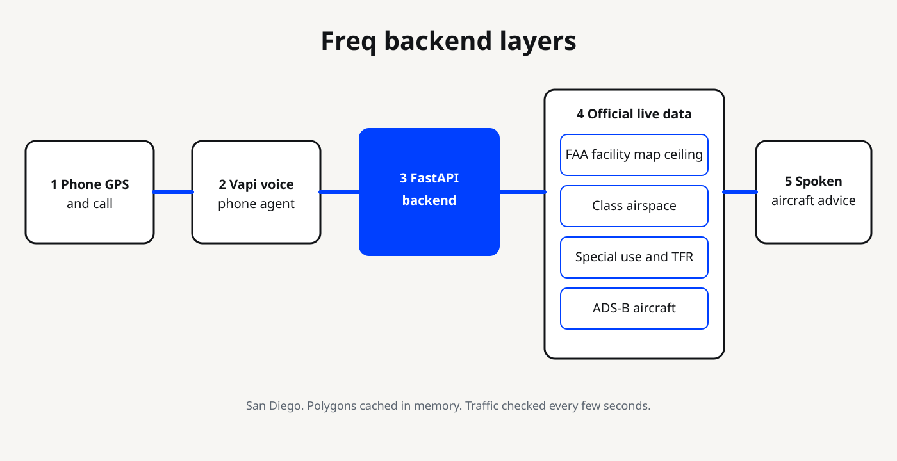
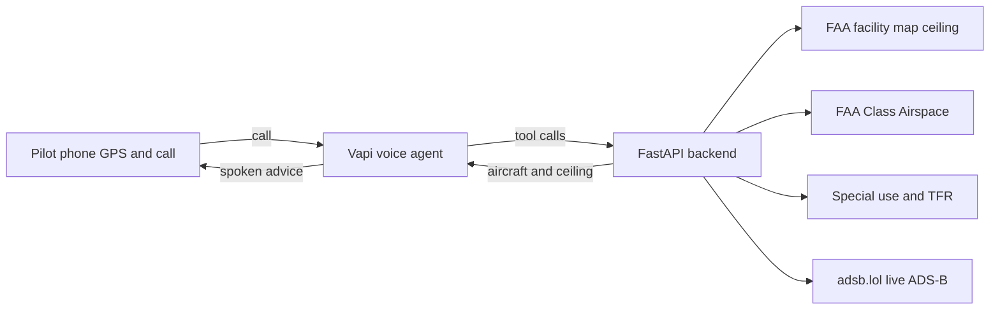

# Freq: your personal traffic control for drones

**Call one number. Keep your eyes on the drone. Freq is in your ear.**

Freq gives every solo drone pilot their own AI traffic controller on a phone call. You call before takeoff and it stays on the line the whole flight. Like a controller on the radio, it tells you how high you can fly, whether you need FAA LAANC approval, what aircraft are around you, and when to descend or land. Everything it says comes from live official data.

Built for the **Dispatch** track and the **Invisible Interfaces** challenge at c0mpiled-16 (UCSD).

📞 **Demo line:** +1 (858) 348-9143 · 🌐 [freq-ai.pages.dev](https://freq-ai.pages.dev)

---

## The problem
Pilots who fly alone get hurt by two things: they don't know the rules for the spot they're standing on, and they can't watch the sky while they watch the screen.

- **Lots of drones:** the FAA estimates about **1.6M recreational drones** in the US ([FAA Aerospace Forecast 2026](https://www.faa.gov/data_research/aviation/aerospace_forecasts/2026_Emerging_Aviation_Entrants_Unmanned_Aircraft_Systems_Advanced_Air_Mobility-1.pdf)).
- **Near airports:** the FAA gets **100+ drone sighting reports a month** near airports, with **1,859 in 2025** (FAA UAS Sightings Reports).
- **Real collisions:**

| When / where | What happened | Official finding |
|---|---|---|
| Philadelphia, Feb 2025 | A DJI Air 3 hit a medical helicopter's main rotor | NTSB ERA25LA129: the operator's *"failure to see and avoid"* the helicopter |
| Daytona Beach, Dec 2023 | A drone at 180 ft, where the local limit was 150 ft, damaged an R44's rotor | NTSB: the pilot didn't know the limit |
| Palisades Fire, Jan 2025 | A drone the pilot had lost sight of struck a firefighting Super Scooper | DOT OIG: firefighting aircraft grounded about 30 min; 14 days in prison and $146,765 restitution |

- **Penalties:** fines can reach **$75,000 per violation**. FAA fines in 2025 ranged from $1,771 to $36,770.

## Pain points
1. **The rules change block by block.** In San Diego, a few miles can take you from 400 ft allowed to LAANC-only to no-fly.
2. **The information lives on screens.** FAA maps and live aircraft positions are public, but you have to look at them, and a pilot's eyes are on the drone.
3. **Solo pilots have no spotter.** Pro crews put a second person on the sky. Hobbyists fly alone and can't call a tower.

## Target users
- **Hobbyists and beginners** who just bought a drone and don't know airspace rules.
- **Student creators and influencers** filming alone at beaches, parks, and campuses.
- **Anyone without pricey hardware:** no ADS-B receiver, no second person, just a phone.

## The solution: a controller in your ear
Freq does the job a spotter and a controller would do, by voice:

| Freq tells you | From |
|---|---|
| Max altitude here, and whether you need LAANC approval | FAA UAS Facility Map (LAANC grid), live |
| Which airspace you're in (Class B, C, D, or G) | FAA Class Airspace, live |
| Aircraft and helicopters nearby: distance, direction, height, and whether they're closing | Live ADS-B (adsb.lol) |
| What to do now: clear, descend to 100 ft, or land now | Freq's advisory rules |

**Why a phone call:** there's no app or new hardware, it works on any phone, and your hands and eyes stay on the drone.

### Example call (illustrative)
> **Freq:** Freq on. Where are you flying?  
> **Pilot:** I'm at La Jolla Cove.  
> **Freq:** Class G. You're clear up to 400 feet. One aircraft six miles southeast, not a factor.  
> **Pilot:** Moving to Mission Bay.  
> **Freq:** San Diego Class B. You need LAANC approval here. With approval, max 100 feet.  
> **Freq:** *(cuts in)* Helicopter one mile north, low, heading your way. Descend to 100 feet now.  

### Live results in San Diego
| Spot | Freq says |
|---|---|
| La Jolla Cove | Class G, up to 400 ft |
| Mission Bay | Class B (SAN), LAANC required, max 100 ft |
| UTC | Class B, LAANC required, max 400 ft |
| Miramar / North Island | 0 ft ceiling, do not fly |

## How it works

1. The pilot shares this phone's GPS on the website, then the call uses that fix.
2. The FastAPI backend checks the LAANC grid, class airspace, special-use and TFR layers, then live ADS-B. It skips aircraft on the ground and stale positions.
3. The voice may only state numbers that came from the tools (`get_situation`, `get_ceiling`, `get_nearby_traffic`), and it leads with the aircraft nearby.

## Scope (this hackathon build)
- **In:** San Diego, with a focus on La Jolla. Live altitude advice and ADS-B traffic alerts by voice.
- **Out (for now):** GPS from the drone, other drones, filing LAANC requests, and anywhere outside San Diego.

## Stack
Vapi (voice + phone) · GPT-4.1 mini · FastAPI backend · FAA ArcGIS services · adsb.lol · Cloudflare Pages + Supabase Auth (website)

## Limits
- **Advisory only.** It is not FAA-approved, it does not provide collision avoidance, and it does not replace FAA air traffic control.
- **Location is this phone's GPS**, not the drone's position.
- **Only aircraft that broadcast ADS-B are visible.** Other drones and most gliders are not.

## Roadmap: scaling up
1. **Now: personal traffic control for solo pilots.** One call gives one pilot live altitude advice and traffic alerts in San Diego.
2. **Next: pros and enterprise fleets.**
   - Live GPS from the drone itself instead of the phone, using Remote ID (most drones now broadcast their ID and position under FAA rules) and telemetry. This is also how Freq starts seeing other drones.
   - Many drones at once: a fleet dashboard for survey, film, and inspection teams.
   - TFR and wind alerts, LAANC request filing, and nationwide coverage.
3. **Vision: a personal traffic controller for every pilot.**
   - Every pilot gets their own Freq controller that knows their drone, their airspace, and the traffic around them.
   - Freq exposes airspace and traffic as an **MCP server**, so other AI agents and drone apps can ask "is it safe to fly here?"
   - Freq controllers share position and intent with each other, so they can warn pilots drone to drone, which nothing gives hobbyists today.
   - Freq works alongside FAA systems like LAANC and UTM (the FAA's framework for drone traffic management).

**The long-term goal is that no pilot flies alone.**

## Team
Christian Lee (UCSD) · built at c0mpiled-16
